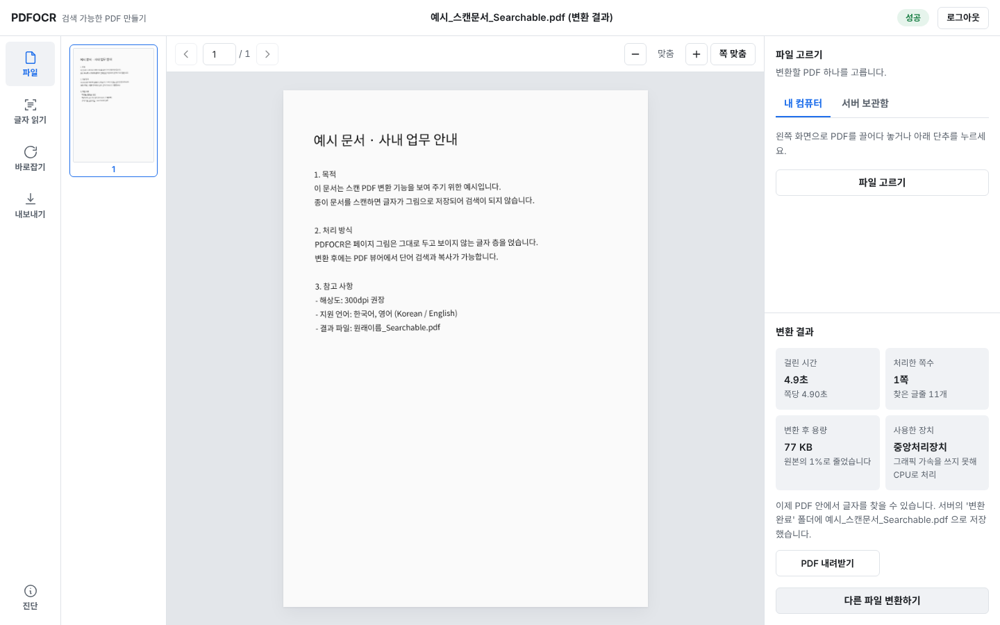

# PDFOCR

> A self-hosted web app that turns scanned PDFs into **searchable PDFs** (Korean + English OCR).
> The page image stays untouched; an invisible text layer is added on top.
> GPU-accelerated when available (CUDA / DirectML), with automatic CPU fallback.

스캔한 PDF에서 한글과 영문을 읽어, **글자 검색이 되는 PDF**로 바꿔 주는 웹 프로그램입니다.
보이는 모습은 그대로 두고 눈에 보이지 않는 글자만 얹기 때문에, 변환 뒤에도 문서 모양이 달라지지 않습니다.



---

## 주요 기능

- **검색 가능한 PDF 만들기** — 원본 화질을 그대로 두고 투명한 글자 층만 얹습니다. 용량을 줄이는 방식도 고를 수 있습니다.
- **그래픽카드 자동 판별** — NVIDIA는 CUDA, AMD·Intel은 DirectML, 그 밖에는 CPU로 알아서 처리합니다.
- **뒤집힌 스캔본 바로 세우기** — 첫 쪽을 네 방향으로 읽어 보고 가장 잘 읽히는 방향으로 문서 전체를 돌립니다.
- **글자 파일 함께 저장** — 읽은 내용을 `txt` · `md` · `docx`로도 내보냅니다.
- **브라우저에서 읽기(시험 기능)** — 접속한 PC의 그래픽카드(WebGPU)로 글자를 읽고, 서버는 결과 PDF만 만듭니다.
- **이미 글자가 있는 PDF 경고** — 스캐너가 OCR한 파일을 다시 변환해 글자가 두 겹이 되는 일을 막습니다.
- **로그인 보호** — 첫 로그인 때 비밀번호를 바꾸기 전에는 다른 화면을 쓸 수 없습니다.

## 기술 스택

| 구분 | 사용 기술 |
|---|---|
| 서버 | Python · FastAPI · Uvicorn · Jinja2 |
| OCR | RapidOCR + ONNX Runtime (GPU / DirectML / CPU) |
| PDF 처리 | PyMuPDF · Pillow · python-docx |
| 브라우저 OCR | PaddleOCR.js (WebGPU) |
| 배포 | Docker · Docker Compose |

## 빠른 시작

```powershell
python -m venv .venv
.\.venv\Scripts\Activate.ps1
python scripts\setup.py          # 이 PC의 그래픽카드에 맞는 OCR 부품까지 설치
python -m uvicorn app.main:app --port 8000
```

브라우저에서 `http://127.0.0.1:8000` 으로 접속합니다.
서버에 올릴 때는 `docker compose up -d --build` 한 줄이면 됩니다.

## 더 알아보기

설치 단계별 설명, 화면 사용법, 성능 수치, 문제 해결 방법은 **[docs/GUIDE.md](docs/GUIDE.md)** 에 정리해 두었습니다.

---

만든 사람: [hunmonkey](https://github.com/hunmonkey)
